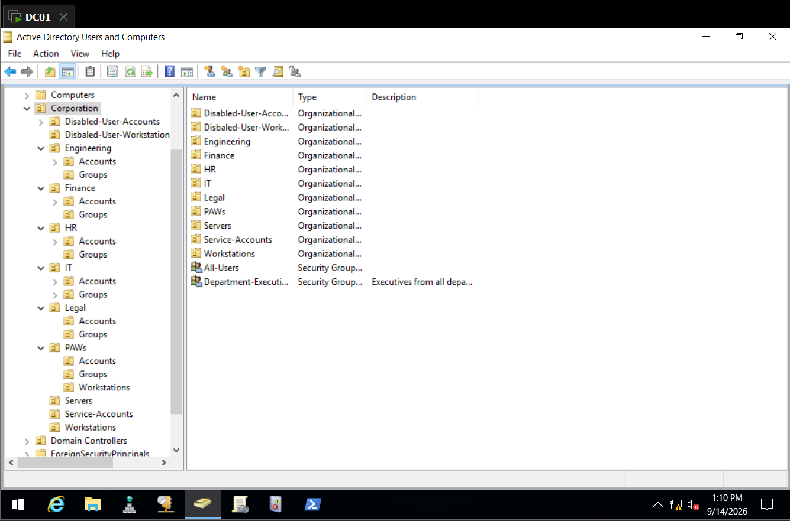

## Overview
Active Directory OU Hierarchy documents the configuration settings and *OU hierarchy* of Active Directory local domain environment.
## OU Hierarchy

							*Active Directory OU Hierarchy*

- **Corporation-wide Groups:**

|         Name          |                      Path                      |                                                                                              Description                                                                                               |
| :-------------------: | :--------------------------------------------: | :----------------------------------------------------------------------------------------------------------------------------------------------------------------------------------------------------: |
|       All-Users       |       `home.local\Corporation\All-Users`       | Security group containing all user accounts across every department, used to apply domain-wide policies, permissions, or resource access that should apply to every employee regardless of department. |
| Department-Executives | `home.local\Corporation\Department-Executives` |                    Security group for department head/executive-level users, used to grant elevated or cross-department permissions distinct from standard department staff access.                    |

- Every Department OU contains 2 OUs
	- Accounts - Contains department's User Accounts, Delegated control to *IT-Support* group.
	- Groups - Contains security groups for managing permissions to shares, files and resources.
- `IT-Support` security group has the following access over the `Accounts` OU of every department:
	- Password reset - allows support members to reset password for accounts.
	- Unlock account - allows support members to unlock locked accounts

|        Name        |                                             Path                                             |                                                                                                                         Description                                                                                                                          |
| :----------------: | :------------------------------------------------------------------------------------------: | :----------------------------------------------------------------------------------------------------------------------------------------------------------------------------------------------------------------------------------------------------------: |
|    Engineering     |            `home.local\Corporation\Engineering` - ***Groups*:** *Engineering*             |                                                   Department OU for Engineering user accounts and resources; contains the Engineering security group for granting access to department-specific resources.                                                   |
|      Finance       |    `home.local\Corporation\Finance` - ***Groups*:** *Finance*, *Finance-Audit-Access*     |                                                 Department OU for Finance user accounts; includes a general Finance group plus a Finance-Audit-Access group for delegated access to audit-related resources.                                                 |
|         HR         |           `home.local\Corporation\HR` - ***Groups*:** *HR*, *HR-Payroll-Access*           |                                                        Department OU for HR user accounts; includes a general HR group plus an HR-Payroll-Access group for delegated access to payroll systems/data.                                                         |
|         IT         |    `home.local\Corporation\IT` - ***Groups:*** *IT*, *IT-Support*, *IT-Support-Admins*    | Department OU for IT staff accounts; contains the general IT group, an IT-Support group used to delegate Help Desk tasks (password resets, account unlocks) across Department\Accounts OUs, and an IT-Support-Admins group for elevated support permissions. |
|       Legal        |       `home.local\Corporation\Legal` - ***Groups:*** *Legal*, *Legal-Cases-Access*        |                                                    Department OU for Legal user accounts; includes a general Legal group plus a Legal-Cases-Access group for delegated access to case-related resources.                                                     |
|        PAW         | `home.local\Corporation\PAW` - ***Groups:*** *PAW-Admins* - ***Workstations:*** *WS01* |                                          Privileged Access Workstation OU housing privileged admin accounts, the PAW-Admins group, and dedicated PAW machines (e.g., WS01), isolated from standard workstation OU.                                           |
|      Servers       |                               `home.local\Corporation\Servers`                               |                                                             Management-level OU containing domain-joined server computer accounts (e.g., FS01), redirected from the default Computers container.                                                             |
|  Service-Accounts  |                          `home.local\Corporation\Service-Accounts`                           |                                                                         Management-level OU for service account objects used by applications/services rather than interactive users.                                                                         |
|    Workstations    |                            `home.local\Corporation\Workstations`                             |                                                               Management-level OU containing standard end-user workstation computer accounts, redirected from the default Computers container.                                                               |
| Domain Controllers |                               `home.local\Domain Controllers`                                |                                                                                        Default built-in OU holding domain controller computer accounts (e.g., DC01).                                                                                         |

- OUs for disabled Objects:
	- `Disabled-User-Accounts` and `Disabled-User-Workstations` are dedicated OUs to store non-admin user account and computer objects that are either decommissioned or disabled. 

|            Name            |                        Path                         |                                                                  Description                                                                   |
| :------------------------: | :-------------------------------------------------: | :--------------------------------------------------------------------------------------------------------------------------------------------: |
|   Disabled-User-Accounts   |   `home.local\Corporation\Disabled-User-Accounts`   | Quarantine OU for disabled user accounts (e.g., terminated or inactive employees), separating them from active accounts in the department OUs. |
| Disabled-User-Workstations | `home.local\Corporation\Disabled-User-Workstations` |     Quarantine OU for disabled/decommissioned workstation computer accounts, separating them from active machines in the Workstations OU.      |

